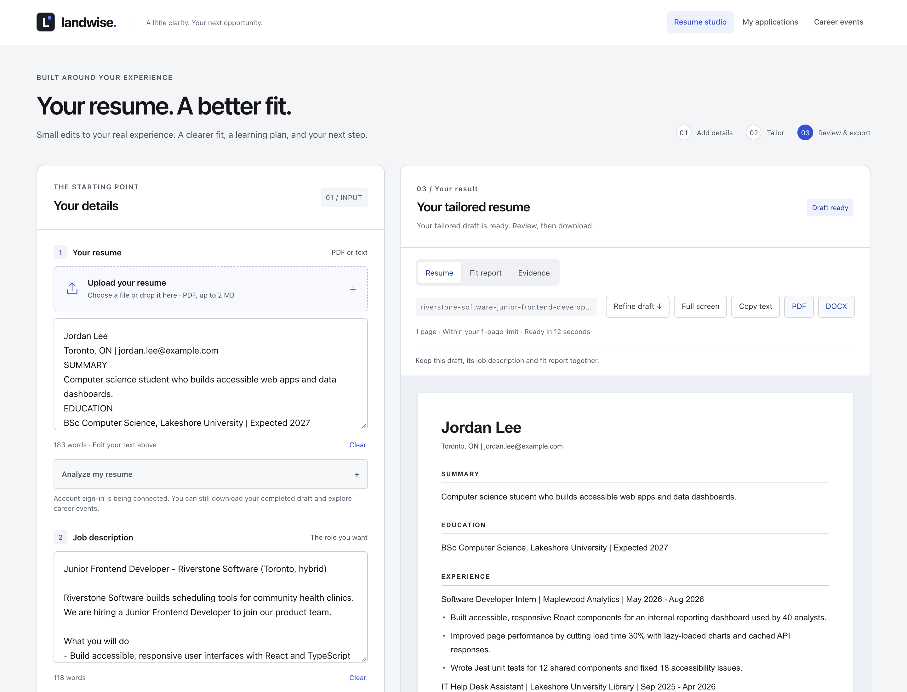
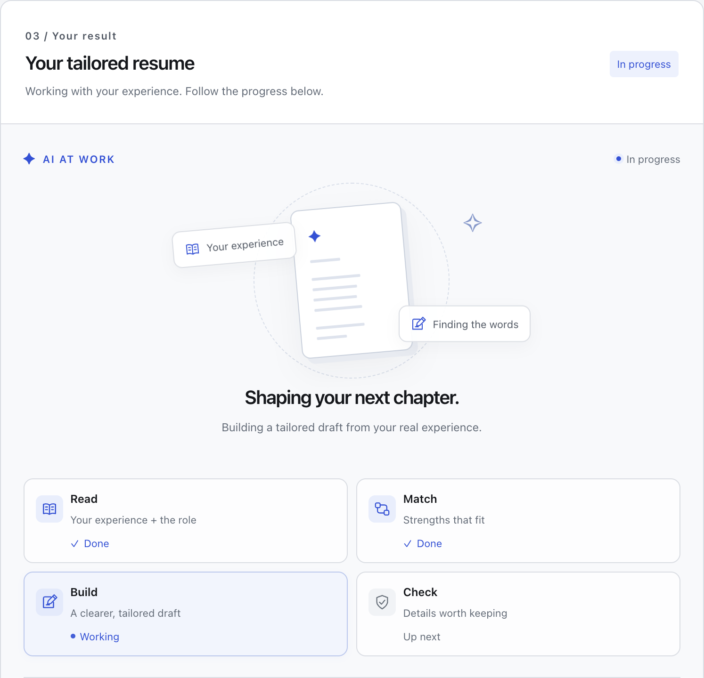
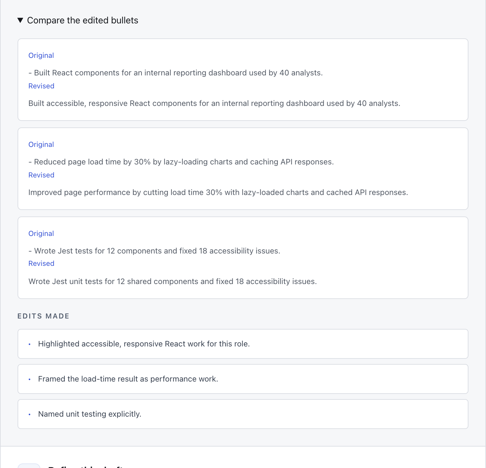
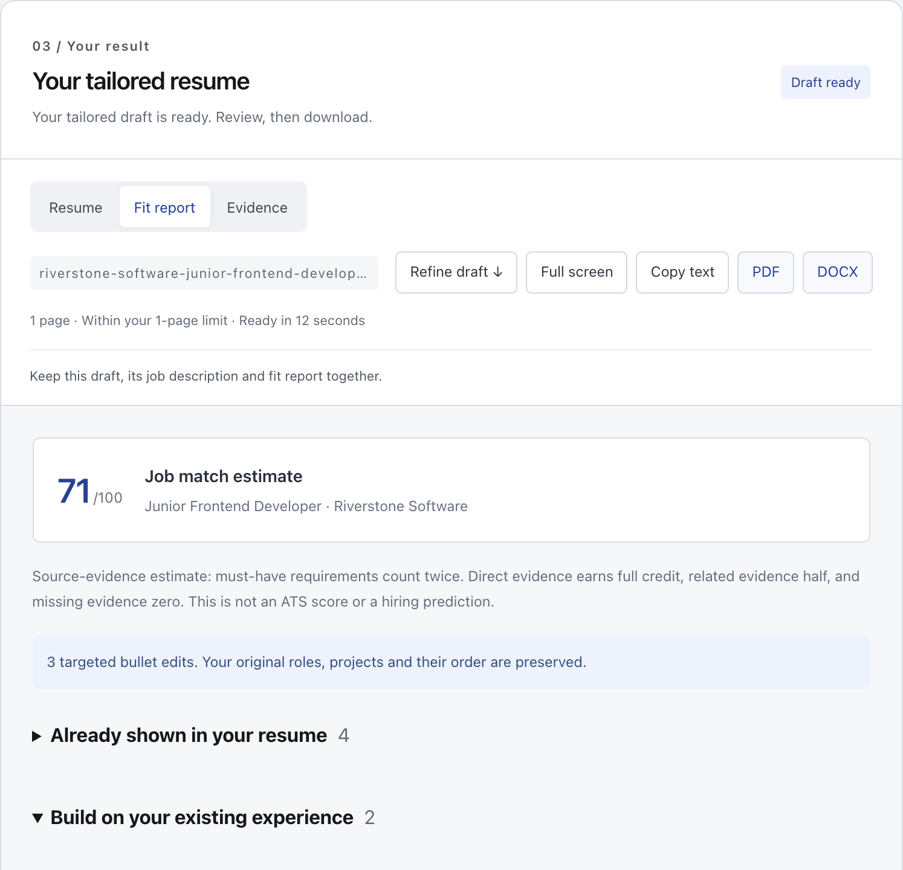
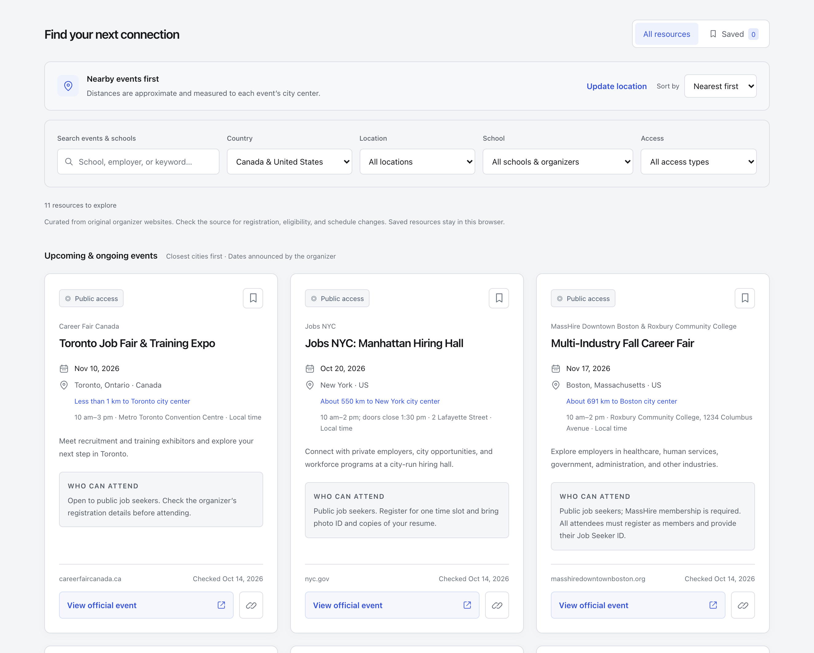

# Landwise

**Your resume. A better fit.**

Landwise uses AI to tailor your resume to a job with small edits to the bullet
points you already wrote. It shows how well you fit and what to learn next,
and lists hand-picked career fairs in Canada and the United States. Built for
students.

 

 

### [🌐 Try it at landwise-nu.vercel.app](https://landwise-nu.vercel.app)

One free tailoring per browser: no account, no email, no API key. 
Screenshots show an invented student and job from a scripted demo run, so
real timings may differ.

 

## Why

AI resume rewriters can make you sound like someone else, or slip in skills you
don't have. Landwise starts from your own words instead. The AI can only
suggest edits to the bullet points you already wrote, and code checks every
edit against your original resume before you see it. You get a resume that
still sounds like you, an honest picture of where you fit, and a next step for
every gap.

## Features

- ✍️ **Small edits, never a rewrite** — the AI can only change existing bullet
  points (lines starting with -, • or *), and server code applies its edits to
  your original text. Every other line, like your name, contact details,
  headings, and role and date lines, keeps your exact words (the preview and
  downloads show common headings in capitals). No line is added, removed or
  moved, and at most 35% of bullets, rounded up, change per run.
- 🔎 **Evidence from your own words** — a fact counts as evidence only if its
  quote is found in your original resume. Requirements without evidence become
  gaps to work on, and a draft that adds a key term listed for one of those
  gaps is rejected. That check matches exact words, so a synonym can still slip
  through.
- 🔢 **Your numbers stay yours** — each edited bullet keeps the numbers it
  started with, and a draft with any new number is rejected. This covers
  numbers written in digits, like 30% or 40, not numbers written as words.
- 📊 **A fit report you can act on** — see which requirements your resume
  already shows, which to build on, and which to learn or prove first, with a
  next step for each. The match score is worked out by code from the AI's
  matches to quotes in your original resume, so the draft's new wording can't
  raise it. Because the AI judges the matches, the score can vary between runs.
  It's an estimate, not an ATS score or a hiring prediction.
- 📄 **A page count you can trust** — the page count shown in the app comes
  from the same layout code that builds the PDF, so the two match. Text starts
  at 11 pt and never goes below 10.5 pt. If a draft still can't fit your page
  limit, you get an error, not tinier text or cut lines.
- ⬇️ **PDF and Word downloads** — built in your browser from the draft on
  screen, named after the job, with no watermark. The Word file copies the
  PDF's line and page breaks, so editing it, or opening it without the Arial
  font, can shift lines and pages. Check it before you send it.
- ⏱️ **Watch it work** — Read, Match, Build and Check follow the server's real
  progress, not a timer. Cancel any time; if something fails, your resume, job
  description and previous draft stay where they were.
- 🗓️ **Career events** — a hand-picked list of career fairs and organizer
  calendars in a few Canadian and US cities, each linked to the organizer's own
  page and sorted by distance if you share your location.
  [More below ↓](#career-events)
- 🆓 **Free to try** — on the live site you get one free tailoring per browser,
  with no account, email or API key, and Landwise doesn't charge visitors. If a
  run fails, you keep your free tailoring, but every try counts toward small
  daily limits.
- 💻 **Or use your own ChatGPT plan** — if you're comfortable running a Node.js
  project, a local version on your computer signs in with your ChatGPT account,
  where OpenAI allows it for your plan. No API key is needed, and your plan's
  own usage limits apply. [Local setup →](docs/LOCAL_DEVELOPMENT.md)

## How a tailoring works

<table>
<tr>
<td align="center" width="33%"> <b>1 · Watch it work</b> Read, match, build, check</td>
<td align="center" width="33%"> <b>2 · See what changed</b> Each edited bullet, before and after</td>
<td align="center" width="33%"> <b>3 · See where you fit</b> Evidence, gaps and next steps</td>
</tr>
</table>

Upload a PDF or paste your resume, paste the job posting, and check the page
limit. It starts at your PDF's page count, or an estimate for pasted text, and
you can change it. Then Landwise works in four steps:

1. **Read.** It lists the job's requirements and quotes facts from your resume.
   A quote that isn't in your resume is thrown out.
2. **Match.** Each requirement is linked to your quoted evidence as a direct
   match, a related one, or a gap.
3. **Build.** The AI suggests edits to a few bullet points, aimed at the role.
4. **Check.** Code applies the edits to your original resume and rejects the
   draft if it breaks a rule, such as too many edits, changed numbers, dropping
   an email or Education heading your original had, or adding key terms from
   requirements you can't support. Then it lays out the pages. If the draft
   runs long, Landwise asks the AI to shorten it once, and stops with an error
   if it still doesn't fit.

## Career events

Find hand-picked campus and public career fairs, plus organizer calendars, in a
handful of cities in Canada and the United States. Then walk in with a resume
that fits the role. No account needed.

- **From the source** — every listing links to the organizer's own page and
  shows who can attend and when it was last checked. You register with the
  organizer.
- **Nearby first** — share your location to sort events by distance. It's
  rounded, kept in memory, and never sent to Landwise or a map service.
  Distances are to each city center.
- **Filter and save** — search, filter by country, city, school and access,
  sort by nearest or soonest, and save events in your browser.
- **Past events hide themselves** — events drop off after their last day.
  Listings are curated by hand, so check the organizer's page before you go.

## Your data

- **No account to try it.** Your inputs and drafts are kept in the open tab,
  not in an account. Refreshing or closing the tab clears them, so download
  your draft first.
- **What the AI sees.** On the live site, your resume and the job posting are
  sent to OpenAI to make your draft.
- **What the live site keeps.** Each run is recorded with fingerprints of your
  input, browser and internet connection, not your resume text, and these
  records are kept. A copy of each finished draft, which includes your resume
  text and fit report, is cached on the server so a dropped connection can be
  recovered by retrying in the same open tab. It can't be recovered after you
  refresh or close the tab, and it isn't an account library or a backup. It
  stops being recoverable after 7 days and is removed during later site
  activity.
- **A cookie**, kept for a year, lets Landwise know when you've used your free
  tailoring.
- **Uploaded PDFs** are read in memory and never written to disk.
- **Server logs** record steps, timings and status codes, never your resume or
  job description.
- **Location** for nearby events is rounded, kept in memory, and never sent to
  the server. Saved events stay in your browser.

## Good to know

- Checks compare text, not meaning. A short quote can match inside a longer
  word ("Java" inside "JavaScript"). Only numbers written in digits are
  checked, not the words around them: "$1.5M" changed to "$1.5B" would pass,
  and a number written as a word, like "five", isn't checked at all. Read every
  draft before you send it.
- Some accented letters (like Ł or ř) and non-Latin scripts don't display
  correctly in the PDF, wherever they appear in your resume. The Word download
  keeps them. Job postings written mostly in non-Latin scripts are not
  accepted.
- Resumes longer than about two pages may be too large to tailor, especially
  with a long job posting, even though the app accepts up to 30,000
  characters. If tailoring a long resume fails, shorten the resume or the job
  posting and try again.
- Only one tailoring runs at a time on the live site, and there are small daily
  limits for the whole site and for each internet connection, so a shared
  campus network can run out sooner. Every try counts, even one that fails. If
  you hit a limit, try again later, which can mean tomorrow.

## Coming soon

Accounts are built but not switched on for the live site yet. They add saved
applications with versions, notes and interview practice tracking, follow-up
edits such as "shorten the bullets", and resume analysis. The local version
already includes these, saved on your computer by default.

## For developers

Landwise is a React 19 and Vite app with an Express 5 API, hosted on Vercel.
The live site uses Supabase (PostgreSQL) for usage limits, its spending ledger
and a 7-day cache of finished drafts, and the OpenAI API for tailoring. Setup,
commands, project structure and hosting costs are in the
[developer guide](docs/DEVELOPMENT.md).

[Architecture](ARCHITECTURE.md) · [Quality rules](QUALITY.md) ·
[Security](SECURITY.md) · [Operations](docs/OPERATIONS.md) ·
[Deployment](docs/DEPLOYMENT.md) · [Local studio](docs/LOCAL_DEVELOPMENT.md) ·
[Supabase](docs/SUPABASE.md)

## License

There is no license yet, so all rights are reserved. You can read the code and
fork it on GitHub, but not reuse it elsewhere without permission.
